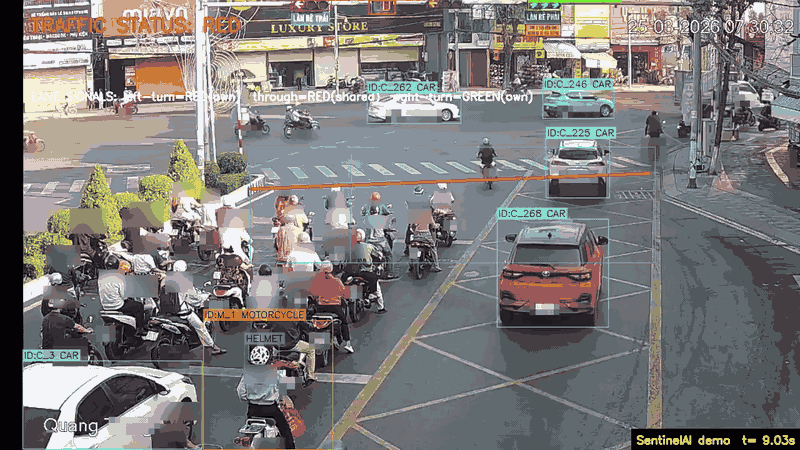
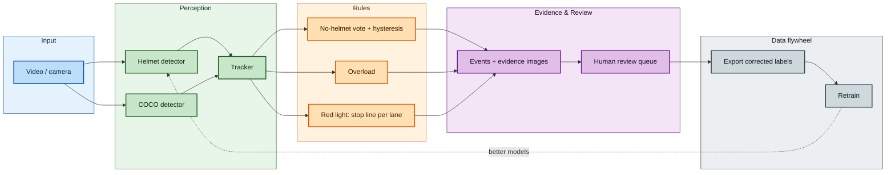

# SentinelAI – traffic-violation detection with a human in the loop

Detects riders without a helmet, motorcycles carrying more than two people and red-light running in traffic video; tracks vehicles, saves evidence per event, and puts every event in front of a person before it counts as a violation.



*The 12.5 s clip is anonymised (heads, pedestrians and plates blurred with `tools/anonymize.py`). The banner says "pending review": **on this clip every no-helmet alarm was a false alarm** (see below).*

## Highlights
Every number links to the experiment it comes from.
- **Found and fixed a leaking benchmark.** The original helmet split was a random frame split of 16 videos: 100% of its validation/test images sit in groups of consecutive frames that also appear in another split, and 75.6% of the test images have a training frame of the same video at most one frame away ([EXP-011](experiments/EXP-011-data-leakage/NOTES.md)). I re-split by video (17 groups, [EXP-013](experiments/EXP-013-splits/NOTES.md)) and retrained: test mAP50 **0.934** (no-helmet 0.844) on videos never seen in training ([EXP-015](experiments/EXP-015-helmet-grouped-3cls/README.md)), against 0.994 on the leaky validation split of the original run ([EXP-000](experiments/EXP-000-kaggle-original/NOTES.md)).
- **Measured on a camera the model never saw, and found it raises false alarms.** On a 26 s out-of-domain clip every no-helmet / overload alarm of five pipeline versions was checked by eye: **all were false alarms**. False alarms per minute: 32.0 for the original model, **16.0 for the EXP-015 model now used as default** ([EXP-020](experiments/EXP-020-regression-diag/README.md), [EXP-025](experiments/EXP-025-default-model-exp015/README.md)). Base-rate analysis there: the test split has 23.6% no-helmet heads, a street far fewer, so with an assumed 1% real no-helmet share and an assumed 2% false-alarm rate on helmeted riders only about 29% of alarms would be real. Recall could not be measured (no real violation in the clip).
- **Red light by stop line and lane, not by zone.** A rider counts only when the bottom-centre of its track crosses the stop line in the direction of travel while *its lane's* light is red; lanes have their own arrow signals (read with OpenCV from fixed regions), a shared signal or none. The old zone rule flagged a rider waiting at the line (M_257); on the test clip the new rule found 13 line crossings and reported none, and the 4 crossings that happened on red in the right-turn lane were checked by eye: riders turning right on their own green arrow ([EXP-022](experiments/EXP-022-light-roi/README.md)). The helmet model almost never sees motorcycles at the line (13 detections against 1000+ for COCO), so the rule uses COCO tracks ([EXP-023](experiments/EXP-023-track-death/README.md)).
- **Human review closes a data loop.** A `/review` page (keys c / r / u, [screenshot](docs/assets/review.png)) writes an append-only `reviews.jsonl` with the model and its sha256; precision per violation type and per model is computed from those decisions. A rejected no-helmet event exports as a **helmet** label on the whole frame (not an empty label that would punish correct detections): 50 imported reviews gave 29 relabelled frames for the next training round ([review queue](docs/DEVELOPER_GUIDE.md#review-queue-human-in-the-loop)).
- **Engineering you can check.** Stream throughput 2.42x the original prototype, measured as same-session ratios ([EXP-009](experiments/EXP-009-session-variance/NOTES.md), [EXP-010](experiments/EXP-010-ratios-vs-v0/NOTES.md)); rule parameters in seconds so they follow the frame rate ([EXP-019](experiments/EXP-019-timebase/NOTES.md), [EXP-021](experiments/EXP-021-10fps/README.md)); a fast test suite on synthetic tracks, a loopback-only server with an upload whitelist, a pre-commit hook against leaking weights, videos or personal paths.

## Architecture
Colours mark the layers; the dashed arrow is the data flywheel: reviewed, corrected labels feed the next training round.


## Results at a glance
| what | result | source |
|---|---|---|
| in-domain test (video-grouped split, 214 images) | mAP50 0.934, no-helmet 0.844, mAP50-95 0.635 | [EXP-015](experiments/EXP-015-helmet-grouped-3cls/README.md) |
| same model out of domain (26 s clip, checked by eye) | 7 no-helmet/overload alarms, all false: 16.0 per minute (original model: 14 alarms, 32.0 per minute) | [EXP-020](experiments/EXP-020-regression-diag/README.md), [EXP-025](experiments/EXP-025-default-model-exp015/README.md) |
| recall | **not measured** | [EXP-020](experiments/EXP-020-regression-diag/README.md) |
| red light on the clip | 13 stop-line crossings, 0 reported (none was a violation) | [EXP-022](experiments/EXP-022-light-roi/README.md) |
| speed | 2.42x the original prototype (stream FPS ratio, same session) | [EXP-009](experiments/EXP-009-session-variance/NOTES.md), [EXP-010](experiments/EXP-010-ratios-vs-v0/NOTES.md) |
| plate OCR | 0 of 14 plates read: the detected plate is ~26x22 px at 720p | [EXP-008](experiments/EXP-008-ocr/NOTES.md) |

Details, method and caveats: [docs/REPORT.md](docs/REPORT.md).

*Experiment logs (`experiments/*/README.md`) are written in Vietnamese; `REPORT.md` is in English.*

## Run it
```powershell
git clone https://github.com/duyentq-aie/SentinelAI.git; cd SentinelAI
python -m venv venv; .\venv\Scripts\activate
pip install -r requirements.txt                       # torch cu118 wheels: see the comment at the top of the file
# helmet models: GitHub Release "models-v1" (helmet_3cls_exp015.pt = default, helmet_4cls_exp016.pt, SHA256SUMS)
mkdir models_dl; cd models_dl
curl -LO https://github.com/duyentq-aie/SentinelAI/releases/download/models-v1/helmet_3cls_exp015.pt     # default model (no login needed)
curl -LO https://github.com/duyentq-aie/SentinelAI/releases/download/models-v1/helmet_4cls_exp016.pt     # optional
curl -LO https://github.com/duyentq-aie/SentinelAI/releases/download/models-v1/SHA256SUMS; cd ..           # or: gh release download models-v1 -D models_dl, or the Releases page
python tools/verify_models.py models_dl                                           # every line must say ok (sha256 check; the same links were downloaded and verified on 2026-10-21)
mkdir experiments\EXP-015-helmet-grouped-3cls\weights; copy models_dl\helmet_3cls_exp015.pt experiments\EXP-015-helmet-grouped-3cls\weights\best.pt
# also needed in the repo root: yolo11s.pt (COCO, Ultralytics downloads it) and a video such as test_video.mp4.
# plate_best.pt is OPTIONAL and not published: without it the app runs normally, just without the plate search (/api/status shows "plate": disabled and why)
python app.py                                         # http://127.0.0.1:8000/  (loopback only)   review queue: http://127.0.0.1:8000/review
python -m pytest                                      # fast tests, no GPU or models needed
```
More (Docker, configs, tools, the review/export flow, the pre-commit hook): [docs/DEVELOPER_GUIDE.md](docs/DEVELOPER_GUIDE.md).

## Limits (read before quoting any number)
- **One out-of-domain clip of 26 seconds**, morning rush hour, one camera. The rules (windows, votes, hysteresis, time ratios) were tuned on that very clip, so its numbers say little about new footage; nothing was tuned from the false-alarm result.
- **Recall is unknown**: the clip contains no recorded real violation, so what the models miss was not measured. The red-light rule has only been shown not to raise false alarms there; catching real runners is untested.
- **Not run on edge hardware.** Speed numbers come from one RTX 3050 Laptop and CPU/ONNX proxies; no Jetson/Rockchip device, no TensorRT.
- **Every no-helmet alarm of the clip was wrong**, so the system is a candidate generator: nothing is a violation until a person confirms it. A second-stage head classifier and better data (relabelled by the review loop) are planned, not built ([PLAN](docs/PLAN.md)).
- Light regions are small (15-22 px) and fixed: a moved camera misreads them, and there is no automatic check yet. The right-turn arrow never turned red in the clip.
- **`plate_best.pt` is not published**: it is not verified that it was trained on the CC BY plate dataset below (its training notebook does not match the weights, [EXP-000](experiments/EXP-000-kaggle-original/NOTES.md)). The plate layer is optional: without the file (or with `models.plate.enabled: false`) the app starts normally, records events without a plate search, and `/api/status` reports `plate: disabled` with the reason. Even with it, the plate text could not be read on this footage (~26x22 px plates).

## Data & attribution
The helmet models are trained on **"helmet plate detection 4"** by **Rajab** (Roboflow Universe, 2024), https://universe.roboflow.com/rajab/helmet-plate-detection-4, licensed under **[CC BY 4.0](https://creativecommons.org/licenses/by/4.0/)** (checked on the Roboflow Universe page: 1,460 images, 4 classes, matching the data used here).
The plate-detector experiments relate to **"vietnamese license plate"** by **school** (workspace school-fuhih, Roboflow Universe, 2023), https://universe.roboflow.com/school-fuhih/vietnamese-license-plate-tptd0, also **CC BY 4.0**. It is **not verified** that `plate_best.pt` was trained on it (the notebook does not match the weights), so `plate_best.pt` is not published.

**Changes made:** the train/validation/test split was redone **by video** (split A, [EXP-013](experiments/EXP-013-splits/NOTES.md)); the 3-class model (EXP-015) drops the `plate` class; the boxes were not relabelled. **The original images are not redistributed** in this repository. The released helmet weights (EXP-015, EXP-016) are derivative works of the first dataset. Details and the data card: [DATA_CARD](docs/DATA_CARD.md).

```bibtex
@misc{ helmet-plate-detection-4_dataset,
    title = { helmet plate detection 4 Dataset },
    type = { Open Source Dataset },
    author = { Rajab },
    howpublished = { \url{ https://universe.roboflow.com/rajab/helmet-plate-detection-4 } },
    url = { https://universe.roboflow.com/rajab/helmet-plate-detection-4 },
    journal = { Roboflow Universe },
    publisher = { Roboflow },
    year = { 2024 },
}

@misc{ vietnamese-license-plate-tptd0_dataset,
    title = { vietnamese license plate Dataset },
    type = { Open Source Dataset },
    author = { school },
    howpublished = { \url{ https://universe.roboflow.com/school-fuhih/vietnamese-license-plate-tptd0 } },
    url = { https://universe.roboflow.com/school-fuhih/vietnamese-license-plate-tptd0 },
    journal = { Roboflow Universe },
    publisher = { Roboflow },
    year = { 2023 },
}
```
(BibTeX in the format of the Roboflow Universe page; the page's month and access-date fields were not recorded here and are left out.)

## Licence
Copyright (C) 2026 Trần Quang Duyên. Licensed under **AGPL-3.0**, kept on purpose: the project builds on Ultralytics YOLO, which is AGPL-3.0, so code and weights follow it ([LICENSE](LICENSE)). Raw videos, evidence images and weights stay out of git; the demo assets in `docs/assets/` are anonymised. Plates and faces are personal data: blur them before publishing any image or clip (`tools/anonymize.py`).
